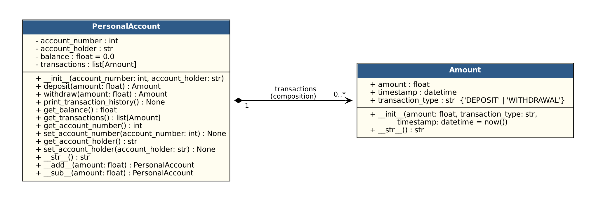

# Personal Bank Account (Python OOP)

A small Python program for managing a personal bank account. It is built
from two classes, **`Amount`** and **`PersonalAccount`**. Together they
handle deposits and withdrawals, keep track of the balance and store a
transaction history.

The project demonstrates core OOP concepts: **classes, objects, methods,
encapsulation, composition and operator overloading**.

## Project structure

```
personal-bank-account/
├── bank_account.py            # Amount and PersonalAccount classes
├── main.py                    # Interactive demo (user input) + auto demo
├── tests/
│   └── test_bank_account.py   # 28 unit tests (unittest)
├── uml/
│   ├── class_diagram.png      # UML class diagram (image)
│   ├── class_diagram.pdf      # UML class diagram (PDF)
│   └── class_diagram.dot      # Graphviz source of the diagram
└── README.md
```

## Requirements

* Python **3.8+**
* No third-party packages (only the standard library: `datetime`, `unittest`)

## How to run

Python is interpreted, so there is no separate compile step.

```bash
# 1. Clone the repository
git clone https://github.com/<your-username>/personal-bank-account.git
cd personal-bank-account

# 2. Interactive program (sample test with user inputs)
python main.py

# 3. Automatic demo (no input required)
python main.py --demo

# 4. Run the unit tests
python -m unittest discover -s tests -v
```

> On Windows, use `py` in place of `python` if `python` is not on your PATH.

### Example session (`python main.py`)

```
=== Create a new account ===
Account number: 555
Account holder name: Aidar

Choose an action:
  1 - Deposit
  2 - Withdraw
  3 - Check balance
  4 - Print transaction history
  5 - Show account info
  6 - Change account holder
  0 - Exit
> 1
Amount to deposit: 1000
  Deposited 1000.00. Balance: 1000.00
> 2
Amount to withdraw: 5000
  Error: Insufficient funds: balance is 1000.00, requested 5000.00.
> 4
Transaction history for account #555 (Aidar):
  Date/Time           | Type       |     Amount
  ---------------------------------------------
  2026-11-16 13:45:24 | DEPOSIT    |    1000.00
  ---------------------------------------------
  Current balance                     1000.00
```

## UML Class Diagram



**Relationship:** `PersonalAccount` ◆—— `Amount` is a **composition (1 to 0..*)**.
An account owns zero or more `Amount` objects in its `transactions` list.
The account creates them itself inside `deposit()` and `withdraw()`, and they
belong to that account only.

Visibility: `-` marks private (encapsulated) attributes and `+` marks public members.

## Class documentation

### `Amount`

Represents a single transaction.

| Member | Description |
|---|---|
| `amount: float` | Transaction amount (must be > 0). |
| `timestamp: datetime` | Date and time of the transaction (defaults to `datetime.now()`). |
| `transaction_type: str` | `'DEPOSIT'` or `'WITHDRAWAL'` (case-insensitive on input). |
| `__init__(amount, transaction_type, timestamp=None)` | Validates the input and creates the transaction. Raises `TypeError` for a non-numeric amount and `ValueError` for an amount ≤ 0 or an unknown type. |
| `__str__()` | Returns e.g. `2026-11-16 13:45:02 \| DEPOSIT    \|     500.00`. |

### `PersonalAccount`

Represents a bank account.

| Member | Description |
|---|---|
| `account_number: int` | Unique positive account identifier. |
| `account_holder: str` | Name of the account holder (non-empty). |
| `balance: float` | Current balance, starts at `0.0`. Read-only from outside the class. |
| `transactions: list[Amount]` | Transaction history. Reading it returns a copy, so the history cannot be changed from outside. |
| `__init__(account_number, account_holder)` | Creates an account with a zero balance and an empty history. |
| `deposit(amount)` | Creates an `Amount('DEPOSIT')`, adds it to the history and increases the balance. Returns the transaction. |
| `withdraw(amount)` | Creates an `Amount('WITHDRAWAL')`, checks that `amount ≤ balance`, adds it to the history and decreases the balance. Raises `ValueError` on insufficient funds; the balance and history stay unchanged. |
| `print_transaction_history()` | Prints every transaction (date, type and amount) and then the current balance. |
| `get_balance()` | Returns the current balance. |
| `get_transactions()` | Returns a copy of the transaction list. |
| `get_account_number()` / `set_account_number(n)` | Getter and setter. The setter requires a positive `int`. |
| `get_account_holder()` / `set_account_holder(name)` | Getter and setter. The setter requires a non-empty string. |
| `__str__()` | `Account #1001 \| Holder: Aidar \| Balance: 1000.50 \| Transactions: 5` |
| `__add__(amount)` | `account + 100` does the same as `account.deposit(100)` and returns the account. |
| `__sub__(amount)` | `account - 50` does the same as `account.withdraw(50)` and returns the account. |

### Usage example

```python
from bank_account import PersonalAccount

acc = PersonalAccount(1001, "Aidar")
acc.deposit(1000)
acc.withdraw(300)
acc = acc + 200        # deposit
acc -= 100             # withdrawal
print(acc.get_balance())   # 800.0
acc.print_transaction_history()
print(acc)
```

## Test cases

The tests are in `tests/test_bank_account.py`. Run them with
`python -m unittest discover -s tests -v`. All **28 tests** pass.

| # | Area | Scenario | Expected result |
|---|---|---|---|
| 1 | Amount | Create a deposit of 100 | amount = 100.0, type `DEPOSIT`, timestamp is a `datetime` |
| 2 | Amount | Type given in lower case (`withdrawal`) | Stored as `WITHDRAWAL` |
| 3 | Amount | Custom timestamp | Timestamp is kept |
| 4 | Amount | Invalid type (`TRANSFER`) | `ValueError` |
| 5 | Amount | Amount 0 or negative | `ValueError` |
| 6 | Amount | Amount `"100"` or `True` | `TypeError` |
| 7 | Amount | `str()` | Contains the date, type and amount |
| 8 | Account | New account | Balance 0.0, empty history, correct number and holder |
| 9 | Account | Invalid constructor arguments | `TypeError` / `ValueError` |
| 10 | Deposit | Deposit 500 | Balance 500, one `DEPOSIT` transaction |
| 11 | Deposit | Several deposits (100 + 200.25 + 0.75) | Balance 301, three transactions |
| 12 | Deposit | Deposit −100 or 0 | `ValueError`, nothing changes |
| 13 | Withdraw | Deposit 1000, withdraw 400 | Balance 600, last transaction is `WITHDRAWAL` |
| 14 | Withdraw | Withdraw the whole balance | Balance 0 |
| 15 | Withdraw | Withdraw 100.01 from a balance of 100 | `ValueError`, balance and history unchanged |
| 16 | Withdraw | Withdraw from an empty account | `ValueError` |
| 17 | Withdraw | Withdraw a negative amount | `ValueError` |
| 18 | Operators | `account + 300` | Balance 300, returns the same object |
| 19 | Operators | `account - 120` | Balance 180, `WITHDRAWAL` |
| 20 | Operators | `account - 1` on an empty account | `ValueError` |
| 21 | Operators | `+=` and `-=` | Balance 30, same object |
| 22 | Setters | Change the number and holder | New values are returned |
| 23 | Setters | Invalid number or empty name | `TypeError` / `ValueError` |
| 24 | Encapsulation | `account.balance = ...`, appending to `transactions` from outside | `AttributeError`; the history is not modified |
| 25 | Output | `str(account)` | Contains the number, holder and balance |
| 26 | Output | `print_transaction_history()` | Lists `DEPOSIT`, `WITHDRAWAL`, the amounts and the balance |
| 27 | Output | History of an empty account | "No transactions yet." |
| 28 | Scenario | deposit → withdraw → `+` → `-` → failed withdrawal | Balance 1000, four transactions in the correct order |
